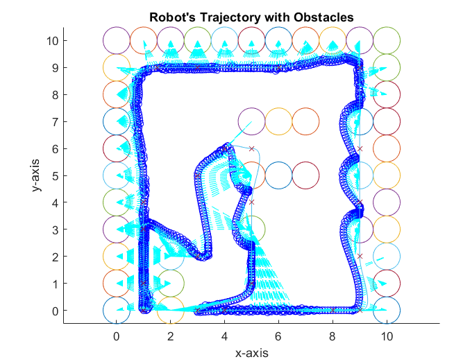
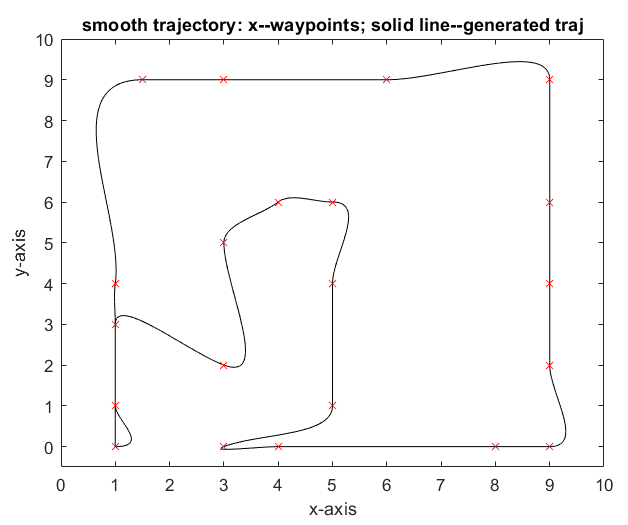
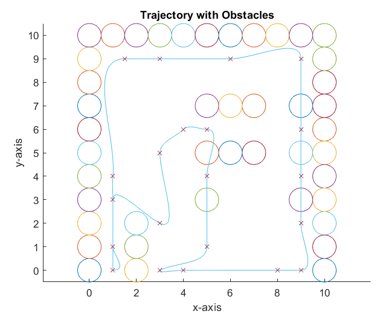
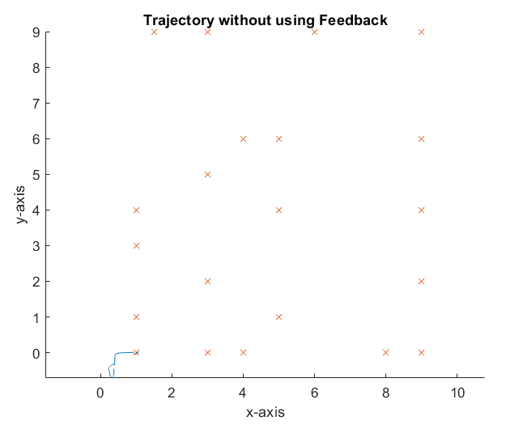
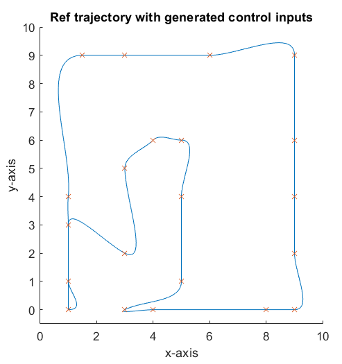
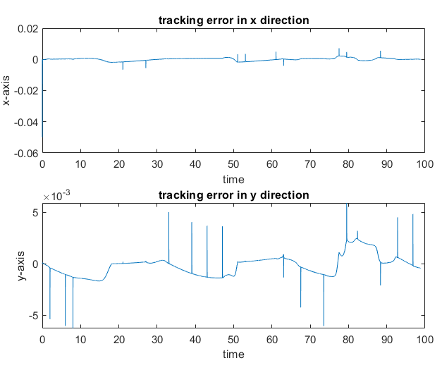

# Car-like robot navigation: trajectory planning, PID tracking and obstacle avoidance

**BEng Electronic & Electrical Engineering, Swansea University · Robotics module (EGA-366), 2021**
MATLAB simulation of an autonomous car-like robot that patrols a chemical plant to monitor for hazardous gas leaks.

<p align="center">
  
</p>

---

## The problem

The coursework described a gas-monitoring robot that follows GPS waypoints around a plant and avoids obstacles with two ultrasonic sensors, turning away whenever one fires. The task was to improve it. I modelled it as a **car-like robot** (more stable on rough ground than a differential drive) and built three improvements:

1. **Smooth trajectory planning** through 24 waypoints, instead of driving straight from point to point.
2. **PID feedback tracking**, so the robot stays on the path even when its controls are disturbed.
3. **Artificial potential field (APF) obstacle avoidance**, so the robot is pulled toward each waypoint and pushed away from nearby obstacles.

## How it works

### 1. Kinematics

The car-like robot is modelled with speed input *u₁* and steering angle *φ*:

```
ẋ = u₁ cos θ      ẏ = u₁ sin θ      θ̇ = u₁ tan(φ) / l
```

To make the system controllable, tracking is done on a reference point a distance *d* ahead of the rear axle, *(x_r, y_r) = (x + d cos θ, y + d sin θ)*. The desired reference velocity is converted back to *u₁* and *φ* by inverting the kinematic matrix.

| Parameter | Value |
|-----------|-------|
| Wheelbase *l* | 0.1 |
| Reference point offset *d* | 0.05 |
| Nominal speed | 0.5 |
| Time step *dt* | 0.01 |

### 2. Trajectory generation

Between each pair of waypoints, `trajgene.m` fits a 4th-order polynomial in *x(t)* and *y(t)* that matches position and velocity at both ends, solving a constrained least-squares (KKT) system. The velocity at each waypoint points toward the next one at the nominal speed, and it is zero at the final waypoint.

| Smooth trajectory through the waypoints | Map with obstacles |
|:---:|:---:|
|  |  |

### 3. PID tracking under disturbance

A disturbance of **0.1 sin(0.1t)** is added to both control inputs to simulate real-world errors such as an imprecise starting position or actuator error. A PID controller (*k_p* = 1, *k_i* = 1, *k_d* = 0.5) on the x and y errors is added to the feedforward velocity from the planned trajectory.

| Without feedback: lost before waypoint 2 | With PID: stays on the planned path |
|:---:|:---:|
|  |  |

<p align="center"><br><sub>Tracking error with PID: x stays within about 0.02 and y within about 0.005 (map units)</sub></p>

### 4. Obstacle avoidance (artificial potential field)

The robot is attracted to the current target waypoint (*F_goal = −k₁(p_r − p_target)*) and repelled by the nearest obstacle inside a safety distance *d₀* = 0.5 (*F_obs = k₂(p_r − p_o)/(|p_r − p_o|² − d₀²)²*). It moves one fixed step (0.1) along the total force while the target advances along the planned path, and skipping several points ahead helps it escape local minima (deadlock). The plant walls and inner structures are modelled as 47 circular obstacles.

## Results

- **Trajectory tracking:** with PID feedback, the robot follows the planned path around the whole plant despite the disturbance. Without feedback, the errors build up and it never reaches the second waypoint.
- **Obstacle avoidance:** the robot avoids the obstacles but misses some waypoints, a known limitation of local APF methods.
- **Possible improvements:** combine APF with global path planning, add a rotational force to escape deadlock, or reduce the obstacle safety distance.

## Files

| File | What it does |
|------|-------------|
| `main.m` | Entry point: PID tracking with disturbance, then APF obstacle avoidance |
| `new_trajectory_generation.m` | Builds the smooth reference trajectory through the waypoints |
| `trajgene.m` | Solves for the 4th-order polynomial coefficients between two waypoints |
| `traj.m`, `generated_speed.m` | Evaluate position and velocity from the coefficients |
| `circle.m` | Draws an obstacle |
| `plot_everything.m` | Produces the trajectory, heading, control input and error plots |

To run it, open the folder in MATLAB and run `main.m`.

## Notes

- The coursework asked students to combine and improve code demonstrated in the module's tutorials, so parts of this code, such as the polynomial trajectory helpers, build on that tutorial code. I adapted and combined it into a single system with the plant map, obstacle layout, disturbance testing, PID tracking and APF obstacle avoidance.
- **Bug fix (2026):** in the original submission, the PID's "previous error" was stored in a misspelled variable, so the derivative term always compared against zero and acted like an extra proportional gain. The current `main.m` fixes this (`Error_lastx`, `Error_lasty`). The plots above come from the original 2021 report, made before the fix.

## Author

**Roby Karan Singh**: BEng Electronic & Electrical Engineering (First Class), MSc Computer Science (Distinction), Swansea University.
[Portfolio](https://robysingh.github.io) · [LinkedIn](https://www.linkedin.com/in/roby-ksingh/)
